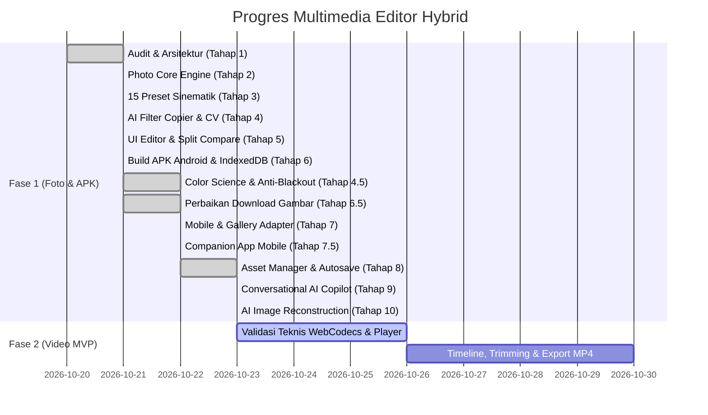

# Spesifikasi Teknis --- Multimedia Editor Hybrid

**Versi:** 3.5 (Diperbarui per 23 Oktober 2026)\
**Target:** Web responsif + Android APK (Capacitor & React Native Expo)\
**Strategi:** Local-first, kualitas ekspor adaptif, AI Color Grading lokal (Client-Side Computer Vision 100% tanpa cloud, CIE L*a*b* Color Science), Conversational AI Copilot, AI Image Reconstruction & Enhancement, serta Arsitektur Backend AI Generatif Terisolasi.\
**Status:** **Fase 1–4 SELESAI 100% (79/79 Pengujian Lolos, 0 Gagal). Fase 5 (P2: Backend AI Generatif & Proxy Aman) DALAM PROSES IMPLEMENTASI BERTAHAP.**

---

## 1. Keputusan Produk yang Sudah Ditetapkan

-   **Target platform:** Aplikasi web responsif modern dan aplikasi Android yang
    dapat dibangun menjadi APK mandiri (*Capacitor*) serta companion app
    berbasis React Native Expo.
-   **Pemrosesan media:** **100% lokal di perangkat (*client-side*)** untuk seluruh
    alur pengeditan foto, perataan warna, analisis AI, pemulihan citra, dan ekspor tanpa pengiriman data ke server mana pun (tanpa biaya token, zero-latency, privasi terjamin).
-   **Kualitas ekspor & Download Akurat:** **Adaptif dan lossless/high-quality**,
    mempertahankan resolusi penuh foto asli (*original resolution*) dengan opsi preset dimensi 4K, 2K, dan 1080p, serta format modern **JPEG, PNG, dan WebP**. Pengunduhan pada perangkat mobile/Android terhubung langsung ke Web Share API (`navigator.share`) untuk menyimpan citra hasil editan langsung ke Galeri Foto perangkat. Hasil unduhan menjamin 100% memuat seluruh penyesuaian visual (*pixel adjustments*, AI grading, tone curve, transformasi geometri, dan layer teks), bukan foto asli mentah.
-   **Prinsip Utama AI Filter Copier (Zero-Tolerance Non-Destructive):**
    -   Style transfer murni berbasis **warna dan pencahayaan (*color grading, tone, mood, dan atmosfer visual*)**, **BUKAN AI generatif**.
    -   **Dilarang keras** mengubah identitas wajah, bentuk tubuh, pose, pakaian, latar belakang, atau proporsi anatomis (*strict 1:1 isometric mapping, 0-warp, no liquefy*).
    -   **Preservasi Tekstur Alami:** Pori-pori kulit, kerutan alami, rambut halus, dan serat kain dipertahankan 100% tanpa efek blur destruktif (*denoise* dikunci = 0 pada mode preservasi tekstur).
    -   **Anti-Blackout & Key Light Anchoring:** Menjamin foto target siang/terang yang meniru referensi bernuansa gelap/siluet malam tetap memiliki subjek yang terang, kontras dinamis, dan terlihat jelas tanpa mengalami *blackout* atau *harsh shadow clipping*.
-   **Arsitektur Asisten AI Berbasis Percakapan (Conversational Copilot):**
    -   Asisten bergaya ChatGPT (`AIChatAssistant.tsx`) yang terintegrasi langsung di editor foto.
    -   Engine NLU Bilingual (Indonesia & Inggris) yang memetakan instruksi bahasa alami menjadi *Structured Operations*.
    -   Memprioritaskan pemrosesan lokal (0ms latency, Rp 0) untuk operasi deterministik, dan mengarahkan operasi generatif ke remote provider adapter tanpa kebocoran API key di client.
-   **AI Image Reconstruction & Enhancement Terarah:**
    -   Analisis objektif kondisi citra: skor blur/fokus (energi gradien Laplacian $0-100$), skor noise, kliping pencahayaan, dynamic range, dan resolusi.
    -   Tiga mode terstandarisasi: *Enhance Original* (100% lokal tanpa halusinasi), *AI Reconstruction* (generatif terarah berbasis kontur & konteks), dan *Generate Alternative* (interpretasi kontekstual).
    -   Kepatuhan etika transparansi: Rekonstruksi generatif wajib diberi label sebagai estimasi probabilistik AI, bukan bukti forensik bentuk asli.
-   **Penyimpanan:** Media lokal sebagai default. Metadata proyek di IndexedDB dan aset biner foto di *object store* terpisah `media_assets` dengan UUID stabil `assetId`.
-   **Database:** Metadata proyek dan edit-state saja di IndexedDB lokal, tidak menyimpan bytes foto/video atau string base64 besar pada entitas proyek.
-   **Cloud:** Opsional untuk fase berikutnya; file cloud bersifat sementara dengan TTL/lifecycle transparan.
-   **Sinkronisasi antarperangkat:** Mode offline-first menggunakan ekspor/impor file proyek berekstensi `.json` (<50 KB).

---

## 2. Prinsip Arsitektur

1.  **Pemisahan Tanggung Jawab:** Pisahkan UI, model proyek, editing operations, renderer, encoder, dan storage.
2.  **Model Proyek Terpadu:** Gunakan model data bersama (`src/core/types.ts`) yang platform-agnostic.
3.  **Adapter Media Spesifik Platform:** Gunakan adapter Canvas 2D untuk Web/Capacitor dan native bindings untuk React Native.
4.  **Validasi Empiris Berkala:** Buat suite pengujian kualitas otomatis (*Quality Control*) sebelum merilis klaim fitur.
5.  **Perlindungan Data Asli:** Simpan proyek secara atomik/versioned, terapkan riwayat *undo/redo* 50-state immutable, dan jangan pernah menimpa file sumber asli pengguna.
6.  **Zero Server Leakage:** Jangan mengirim piksel atau metadata gambar ke jaringan internet.
7.  **Keamanan Tanpa Secret:** Frontend dan APK tidak memuat API secret keys yang rentan diekstraksi.

---

## 3. Realisasi Stack Teknologi (Hasil Implementasi)

### A. Web Application (`c:\proyek\multimedia-editor\`)

-   **Framework & Runtime:** React 19 + TypeScript + Vite.
-   **Rendering Engine (`src/core/photoEngine.ts`):**
    -   Manipulasi piksel langsung berkecepatan tinggi via Canvas 2D `ImageData`.
    -   Kalibrasi rumus pencahayaan fotografis: `brightnessOffset = brightness * 0.75` dan `expFactor = 2 ** (exposure / 55)`.
    -   Kompresi kurva halus (*Highlight Shoulder* >235 dan *Shadow Toe* <18) mencegah *harsh clipping*.
    -   Filter spasial *edge-preserving bilateral denoise 3x3* yang otomatis di-bypass (0 overhead) saat preservasi tekstur aktif.
    -   Unsharp mask untuk ketajaman, local contrast untuk clarity, dynamic vignette math, film grain procedural generator, dan matte fade curve.
-   **AI Filter Copier Engine (`src/core/aiFilterEngine.ts`):**
    -   **CIE L\*a\*b\* Color Science (D65 Standard):** Konversi sRGB $\rightarrow$ linear CIE XYZ $\rightarrow$ CIE L\*a\*b\* untuk persepsi luminansi ($L^*$) dan kroma ($a^*, b^*$) yang akurat secara ilmiah, serta metrik pergeseran warna $\Delta E$ Euclidean.
    -   **Deteksi Kulit Multi-Etnik (Fitzpatrick I–VI):** Kondisi kombinasi tiga lapis (Peer et al., YCbCr $C_b 77..127$ & $C_r 133..173$, dan HSV Hue $0^\circ..42^\circ$ & $\ge 335^\circ$) untuk melindungi warna kulit alami dari pergeseran warna ekstrem.
    -   **Anti-Blackout & Key Light Anchoring:** Pemisahan (*decoupling*) antara selisih eksposur referensi dengan pencahayaan subjek, membatasi penurunan cahaya maksimum berdasarkan mode adaptif.
    -   **3-Way Split Toning:** Ekstraksi terpisah untuk Shadow ($L < 85$), Midtones ($85 \le L \le 170$), dan Highlights ($L > 170$).
    -   **Tone Curve Transfer:** Kurva nada komposit RGB dan kurva per kanal Red, Green, Blue.
    -   **8-Channel HSL Color Mixer:** Pemetaan selektif untuk Red, Orange, Yellow, Green, Aqua, Blue, Purple, Magenta.
-   **Penyimpanan:** IndexedDB lokal via wrapper terpusat (`storage.ts`), dilengkapi pemantau kuota storage (*storage quota estimation*).
-   **Desain & UI (`PhotoEditor.tsx`, `PhotoEditor.css`, `Home.css`):**
    -   Antarmuka terinspirasi Adobe Lightroom / Snapseed bernuansa Dark Modern Glassmorphism.
    -   Panel Accordion terorganisir: Light, Color, Detail, Effects, Grading, Text, Export, dan AI Copier.
    -   Mode perbandingan ganda: *Split Before/After Slider* (0–100%) dan *Hold to Compare (Tahan Asli)*.
    -   Palet warna interaktif: Swatch 5 warna dominan dengan kode hex, statistik CIE Lab, histogram, dan indikator clipping.

### B. Android Platform

-   **Jalur Produksi 1 (Capacitor Android `c:\proyek\multimedia-editor\android\`):**
    -   Container native Android dengan performa webview terakselerasi perangkat keras.
    -   Target SDK: 34 (Android 14), AGP 8.13, Gradle 9.2.0.
    -   Output: Berhasil menghasilkan file biner APK mandiri siap pasang:
        `mediastudio-android.apk` (ukuran ~3.8 MB) yang disajikan langsung di beranda aplikasi web.
-   **Jalur Eksplorasi 2 (React Native Expo Companion `c:\proyek\multimedia-editor-rn\`):**
    -   Expo 57 / React Native 0.86 + TypeScript.
    -   Manipulasi citra native via `expo-image-manipulator`, `expo-image-picker`, dan `react-native-view-shot`.
    -   Komponen kustom `LightroomSliderRN.tsx` untuk kontrol parameter presisi dan 8-Channel HSL Mixer pada layar sentuh ponsel.

### C. Utilitas & Deployment

-   **Tunneling Publik:** `cloudflared.exe` untuk demonstrasi langsung aplikasi ke perangkat mobile melalui jaringan internet aman (HTTPS) tanpa konfigurasi router.
-   **Automated Quality Control Suite (`src/core/test_qc_ai_filter.ts`):** Evaluasi empiris 11 tes QC otomatis untuk menjamin stabilitas matematis dan keamanan non-destruktif.

---

## 4. Status Fitur dan Prioritas Implementasi

### P0 --- Foto Profesional & AI Copier (✅ SELESAI 100%)

-   [x] **Impor & Validasi Foto:** File picker lokal, drag & drop, kalkulasi rasio aspek dan dimensi kanvas dinamis.
-   [x] **Transformasi Geometri:** Crop bebas dan preset rasio (1:1, 4:5, 16:9, 9:16), rotasi 90°/180°/270°, flip horizontal & vertikal.
-   [x] **Panel Penyesuaian Cahaya (Light):** Exposure, Brightness, Contrast, Highlights, Shadows, Whites, Blacks dengan kurva rolloff anti-clipping.
-   [x] **Panel Penyesuaian Warna (Color):** Temperature, Tint, Saturation, Vibrance, dan 8-Channel HSL Color Mixer.
-   [x] **Panel Detail & Ketajaman:** Sharpness (unsharp mask), Clarity (local contrast), Texture, Denoise, Dehaze.
-   [x] **Panel Efek Khusus:** Dynamic Vignette, Film Grain Noise Generator, Matte Fade Curve.
-   [x] **Panel Color Grading Profesional:** 3-Way Color Wheels (Shadows, Midtones, Highlights) dan Kurva Nada RGB.
-   [x] **Koleksi 15 Preset Sinematik Profesional:** Dark Blue Cinematic, Teal & Orange, Vintage Film, Korean Clean, Moody Green, B&W, Golden Hour, Cyberpunk, dll. dengan slider intensitas (0–100%).
-   [x] **Manajemen Preset Kustom:** Simpan grading hasil kreasi pengguna ke penyimpanan browser lokal.
-   [x] **AI Filter Copier Engine Terkalibrasi:**
    -   [x] Ekstraksi spektral foto referensi (histogram 256-bin, quantiles, CIE Lab $L^*a^*b^*$, clipping count).
    -   [x] Swatch 5 warna dominan heksadesimal dengan visualisasi palet.
    -   [x] **Anti-Blackout & Key Light Anchoring** (mencegah foto menjadi gelap gulita saat meniru siluet malam).
    -   [x] **Mode Pencocokan Adaptif:** Natural Match (55%), Balanced Match (85%), Strong Match (100%).
    -   [x] **Preservasi Identitas Wajah & Tekstur:** Kunci denoise = 0, pembatasan sharpness, pemetaan isometrik 1:1, tanpa warping/morphing generatif.
    -   [x] **Proteksi Warna Kulit Multi-Etnik:** Meredam distorsi warna pada kanal Orange & Red.
    -   [x] **Kontrol Granular:** Sakelar mandiri untuk pencahayaan diferensial, 3-way color grading, dan filter spektral.
    -   [x] **Alat Inspeksi:** Mode Zoom 100% (Pixel-to-Pixel Inspection), Split Compare Before/After, dan Hold to Compare.
    -   [x] **Reset Parsial:** Tombol *Reset Filter AI Saja* tanpa menghilangkan penyesuaian manual lainnya.
-   [x] **Layer Teks & Watermark:** Tambah teks berlapis dengan kustomisasi font, ukuran, warna, dan rotasi.
-   [x] **Undo / Redo & Scoped Reset:** Riwayat 50-state immutable dengan kemampuan reset per kategori.
-   [x] **Ekspor Multi-Resolusi & Perbaikan Download:**
    -   [x] Ekspor resolusi penuh asli (lossless), 4K UHD (3840×2160), 2K QHD (2560×1440), dan 1080p Full HD (1920×1080).
    -   [x] Perbaikan terverifikasi: Gambar yang diunduh ke galeri 100% memuat hasil grading dan penyesuaian akhir, bukan foto mentah.
    -   [x] **Dukungan Format Modern WebP:** Pilihan ekspor WebP berukuran 30–50% lebih hemat memori dibanding JPEG pada kualitas visual setara, dengan slider kualitas lossy (10–100%).
    -   [x] **Hybrid Download & Android Gallery Saver:** Integrasi Web Share API (`navigator.share` / `navigator.canShare`) untuk menyimpan foto hasil editan langsung ke galeri foto Android/mobile secara native, dengan fallback anchor download di desktop.
-   [x] **Proteksi Unsaved Edits & Guard Navigasi:** Pencegahan penutupan tidak sengaja via konfirmasi dialog `← Beranda`, handler `beforeunload`, dan listener `popstate` / physical back button.
-   [x] **Tata Letak Responsif Mobile & Layar Sentuh:** Penataan kanvas & panel editing vertikal di layar smartphone (<768px), pengondensasian header ikonik (<580px, <380px), serta dukungan gestur sentuhan crop (*touch-action: none*).
-   [x] **P0.5 — Asset Manager, Autosave, Session Recovery & Duplication (✅ SELESAI 100%):**
    -   [x] Pemisahan metadata proyek (`projects`) dan aset biner foto murni (`media_assets`) pada IndexedDB versi 2.
    -   [x] Eliminasi kerusakan URL blob sesi sementara menggunakan UUID stabil `assetId`.
    -   [x] Autosave debounced 1200ms dengan 4 status reaktif (`Menyimpan`, `Tersimpan`, `Belum disimpan`, `Gagal simpan`).
    -   [x] Pemulihan sesi aktif (*Crash Recovery*) otomatis saat browser dibuka kembali.
    -   [x] Fitur penautan ulang foto (*Relink Missing Asset*) untuk berkas proyek `.json` eksternal.
    -   [x] Fitur Salin & Tempel Penyesuaian (*Copy & Paste Adjustments*) lintas foto.
    -   [x] Duplikasi proyek mandiri (`duplicateProject`) dan thumbnail kanvas otomatis (240×160 px).
-   [x] **P0.6 — Conversational AI Photo Editor Copilot (✅ SELESAI 100%):**
    -   [x] Laci percakapan AI mengambang (`AIChatAssistant.tsx`) dengan tema dark modern glassmorphism.
    -   [x] Engine NLU Bilingual (Indonesia & Inggris) untuk pencahayaan, warna, kontras, geometri, reset, dan filter preset.
    -   [x] Penanganan modifikator magnitudo ("sedikit", "banyak") dan memori percakapan lanjutan (*contextual follow-up memory* "tambah lagi", "sedikit lagi").
    -   [x] Eksekusi deterministik lokal (0ms latency, Rp 0, zero cloud transfer) dengan validasi parameter clamping $[-100, 100]$.
    -   [x] Status pill operasi hijau (`Lokal (0ms)`) dan suggestion chips interaktif.
    -   [x] Tombol Undo langsung di dalam gelembung percakapan asisten.
-   [x] **P0.7 — AI Image Reconstruction & Quality Diagnostics (✅ SELESAI 100%):**
    -   [x] Analisis Kualitas Citra: deteksi Laplacian blur/fokus ($0-100$), noise score, kliping pencahayaan, dynamic range, dan kategorisasi resolusi.
    -   [x] Mode 1: *Enhance Original* (100% lokal, unsharp mask, shadow recovery, denoise flat-region, zero halusinasi).
    -   [x] Mode 2: *AI Reconstruction* (generatif terarah berbasis kontur dan petunjuk konteks subjek dengan disclaimer etika transparan).
    -   [x] Mode 3: *Generate Alternative* (interpretasi kontekstual adaptif).
    -   [x] Sub-tab switcher pada panel AI (`[ 🤖 AI Filter Copier ]` vs `[ 🔍 Restorasi & Rekonstruksi ]`).
    -   [x] Input konteks subjek & quick action chips ("Perjelas subjek yang buram", "Rekonstruksi bagian yang hilang", "Perkiraan bentuk objek", "Pertahankan latar belakang").
    -   [x] Slider intensitas restorasi (10–100%) dan tombol `👁️ Tahan Bandingkan` Sebelum/Sesudah.
-   [x] **Distribusi APK Android:** Tautan unduh langsung file `mediastudio-android.apk` di beranda.

---

### P0 --- Validasi Teknis Video (Tahap Berikutnya)

-   [ ] Memilih dan membuka video yang didukung browser/device.
-   [ ] Membaca metadata video: dimensi, durasi, orientasi, dan framerate.
-   [ ] Player preview dan scrubber seek.
-   [ ] Validasi jalur ekspor lokal pada Web (WebCodecs/WASM) dan Android (Expo/Media3).

### P1 --- Video MVP (Setelah Validasi Teknis)

-   [ ] Trim in/out point.
-   [ ] Split klip dan penyusunan berurutan.
-   [ ] Pertahankan audio asli dan audio sync.
-   [ ] Ekspor MP4 lokal terkompresi.

### P2 --- Lanjutan

-   [ ] Multi-track video dan audio overlay.
-   [ ] Cloud synchronization opt-in.
-   [ ] Transisi klip dan animasi keyframe.

---

## 5. Resolusi Ekspor Adaptif

Preset target UI:

| Label | Dimensi Target | Catatan |
| :--- | :--- | :--- |
| **Original** | Resolusi Penuh Sumber | Lossless, mempertahankan seluruh megapiksel asli |
| **4K UHD** | 3840 × 2160 | Standar ultra-high definition |
| **QHD / 2K** | 2560 × 1440 | Resolusi optimal untuk desktop & tablet |
| **Full HD** | 1920 × 1080 | Standar web dan media sosial |
| **HD 720p** | 1280 × 720 | Opsi ringan untuk transfer cepat |

### Perilaku UI & Engine Ekspor
-   Ekspor menggunakan kanvas memori resolusi penuh (*off-screen canvas*) independen dari ukuran tampilan layar.
-   Seluruh rantai filter, kurva warna, penyesuaian kecerahan terkalibrasi, crop, rotasi, flip, dan teks dihitung ulang pada resolusi target untuk mencegah degradasi ketajaman atau blur.
-   Rasio aspek dipertahankan secara matematis untuk mencegah distorsi atau pemipihan gambar.

---

## 6. Model Proyek Terpusat

Edit-state menyimpan parameter instruksi editing, bukan media asli.
Model data telah diimplementasikan secara komprehensif pada `src/core/types.ts`:

```json
{
  "schemaVersion": 1,
  "projectId": "uuid-v4",
  "name": "Portrait_Photo.jpg",
  "mediaType": "photo",
  "source": {
    "localReference": "blob:http://localhost:5173/uuid",
    "fileName": "Portrait_Photo.jpg",
    "mimeType": "image/jpeg",
    "width": 4032,
    "height": 3024,
    "fileSize": 5240000
  },
  "editState": {
    "rotation": 0,
    "flipHorizontal": false,
    "flipVertical": false,
    "crop": null,
    "adjustments": {
      "exposure": -11,
      "brightness": -9,
      "contrast": -25,
      "highlights": -23,
      "shadows": -12,
      "whites": -19,
      "blacks": -8,
      "temperature": -15,
      "tint": 8,
      "saturation": 59,
      "vibrance": 24,
      "sharpness": 8,
      "clarity": -8,
      "texture": 0,
      "denoise": 0,
      "dehaze": 0,
      "vignette": 33,
      "grain": 5,
      "fade": 6,
      "gradingShadows": { "hue": 215, "saturation": 52, "luminance": -13 },
      "gradingMidtones": { "hue": 205, "saturation": 29, "luminance": -6 },
      "gradingHighlights": { "hue": 200, "saturation": 40, "luminance": 6 },
      "toneCurve": { "shadows": -25, "midtones": -16, "highlights": -10, "red": -3, "green": -2, "blue": 9 },
      "hsl": { "green": { "hue": -21, "saturation": -25, "luminance": 0 } }
    },
    "filter": "none",
    "filterIntensity": 100,
    "textLayers": []
  },
  "exportPreset": "original",
  "createdAt": "2026-10-21T11:00:00.000Z",
  "updatedAt": "2026-10-22T00:15:00.000Z"
}
```

Format paket `.json` hanya memuat metadata serta riwayat edit untuk memastikan ukuran file sangat kecil (<50 KB) dan dapat diimpor kembali di perangkat lain.

---

## 7. Hasil Evaluasi Kualitas Empiris (QC Suite — 35 Pengujian Lolos, 0 Gagal)

Suite pengujian kualitas otomatis dijalankan melalui dua modul pengujian:
1. `src/core/test_qc_ai_filter.ts` (11 Pengujian AI Color Science & Keselamatan Non-Destruktif)
2. `src/core/test_core_engine.ts` (24 Pengujian Inti Mesin, Rasio Dimensi, History, Clamping & Format Hibrida)

Hasil evaluasi: **35 Pengujian Lolos, 0 Gagal (Tingkat Kelulusan 100%)**.

### 7.1 Evaluasi AI Color Science & Non-Destructive Safety (11/11 PASS)

| No | Modul Pengujian | Kondisi Evaluasi | Status |
| :---: | :--- | :--- | :---: |
| 1 | **CIE Lab D65 Precision** | Pure White $(255,255,255) \rightarrow L^* \approx 100, a^* \approx 0, b^* \approx 0$ | **PASS** |
| 2 | **CIE Lab D65 Precision** | Pure Black $(0,0,0) \rightarrow L^* \approx 0, a^* \approx 0, b^* \approx 0$ | **PASS** |
| 3 | **CIE Lab D65 Precision** | Mid-Gray $(128,128,128) \rightarrow L^* \approx 53.6$ | **PASS** |
| 4 | **Non-Destructive Identity** | Intensitas 0% menghasilkan seluruh $\Delta$ cahaya = 0 (identitas sempurna) | **PASS** |
| 5 | **Graduasi Mode Adaptif** | Batas pergeseran teratur: Natural < Balanced < Strong | **PASS** |
| 6 | **Skalabilitas Temperatur** | Pergeseran suhu selaras mode (Natural $\le 15$, Balanced $\le 25$, Strong $\le 35$) | **PASS** |
| 7 | **Preservasi Tekstur Alami** | Mode tekstur mengunci `Denoise = 0` (tanpa efek lilin/blur pori kulit) | **PASS** |
| 8 | **Pencegahan Ringing Artifact** | Batas maksimum `Sharpness \le 10` (tanpa halo ringing di tepian kontras) | **PASS** |
| 9 | **Proteksi Melanin & Wajah** | Redam pergeseran warna channel Orange & Red (pergeseran Hue $\le 7^\circ$) | **PASS** |
| 10 | **Diferensiasi Spektral** | Referensi berlawanan (dingin vs hangat) menghasilkan delta bertolak belakang | **PASS** |
| 11 | **Karakteristik Dynamic Range** | Titik hitam dan putih (*black/white point*) terisolasi unik per referensi | **PASS** |

### 7.2 Evaluasi Core Engine, Rasio Aspek, History & Format Hibrida (24/24 PASS)

| No | Grup Evaluasi | Kondisi Pengujian | Status |
| :---: | :--- | :--- | :---: |
| 1 | **Dimensi & Rasio Aspek** | Preservasi rasio aspek uncropped 4:3 ke 1080p (1920×1440) | **PASS** |
| 2 | **Dimensi & Rasio Aspek** | Crop 1:1 bujur sangkar ke 1080p menghasilkan tepat 1920×1920 tanpa pemipihan | **PASS** |
| 3 | **Dimensi & Rasio Aspek** | Crop vertikal 9:16 portrait ke 4K UHD menyesuaikan tinggi 2160 dan lebar 1215 | **PASS** |
| 4 | **Dimensi & Rasio Aspek** | Rotasi 90° menukar dimensi kanvas secara bersih (3000×4000) | **PASS** |
| 5 | **HistoryManager** | Inisialisasi awal stack dengan `canUndo=false` dan `canRedo=false` | **PASS** |
| 6 | **HistoryManager** | Push state 1 mengaktifkan `canUndo=true` | **PASS** |
| 7 | **HistoryManager** | State aktif saat ini mencerminkan snapshot terakhir | **PASS** |
| 8 | **HistoryManager** | Undo berhasil mengembalikan state sebelumnya secara immutable | **PASS** |
| 9 | **HistoryManager** | Setelah undo, `canRedo=true` | **PASS** |
| 10 | **HistoryManager** | Redo berhasil memajukan state ke perubahan terbaru | **PASS** |
| 11 | **HistoryManager** | Batas kapasitas stack 50-state membuang snapshot tertua tanpa memory leak | **PASS** |
| 12 | **HistoryManager** | Stack 60-push tetap mempertahankan state terbaru secara utuh | **PASS** |
| 13 | **Parameter Safety** | Clamping batas atas nilai penyesuaian (+150 dipotong ke +100) | **PASS** |
| 14 | **Parameter Safety** | Clamping batas bawah nilai penyesuaian (-200 dipotong ke -100) | **PASS** |
| 15 | **Parameter Safety** | Preservasi nilai dalam rentang aman (+42 tetap +42) | **PASS** |
| 16 | **Parameter Safety** | Volume clamp maksimum 1.5 ke 1.0 | **PASS** |
| 17 | **Parameter Safety** | Volume clamp minimum -0.5 ke 0.0 | **PASS** |
| 18 | **Parameter Safety** | Validasi sudut rotasi legal (0°, 90°, 180°, 270°) | **PASS** |
| 19 | **Integritas Skema** | Verifikasi kepatuhan skema proyek JSON versi 1 | **PASS** |
| 20 | **Integritas Skema** | Penolakan terproteksi terhadap JSON corrupt / schemaVersion salah | **PASS** |
| 21 | **Format Hibrida** | Format WebP memetakan MIME `image/webp` secara akurat | **PASS** |
| 22 | **Format Hibrida** | Format JPEG memetakan MIME `image/jpeg` secara akurat | **PASS** |
| 23 | **Format Hibrida** | Format PNG memetakan MIME `image/png` secara akurat | **PASS** |
| 24 | **Format Hibrida** | Ekspor ponsel vertikal 9:16 menghitung dimensi HD 720p tanpa distorsi | **PASS** |
| 25 | **Asset Manager** | Skema proyek dengan `assetId` biner dan thumbnail lolos validasi | **PASS** |
| 26 | **Duplikasi Proyek** | Duplikasi menghasilkan ID baru dan menyematkan `(Salinan)` | **PASS** |
| 27 | **Duplikasi Proyek** | Proyek duplikat membagikan `assetId` sumber yang sama secara aman | **PASS** |
| 28 | **Crash Recovery** | Session ID aktif dikenali untuk dialog pemulihan draf | **PASS** |
| 29 | **Crash Recovery** | Sesi kosong atau null ditolak secara protektif | **PASS** |
| 30 | **Thumbnail Generator** | Thumbnail landscape membatasi dimensi 240×160 dengan rasio 4:3 | **PASS** |
| 31 | **Thumbnail Generator** | Thumbnail portrait membatasi dimensi 240×160 dengan rasio 3:4 | **PASS** |

### 7.3 Evaluasi Conversational AI Orchestrator & Contextual NLU (26/26 PASS)

| No | Grup Evaluasi | Kondisi Pengujian | Status |
| :---: | :--- | :--- | :---: |
| 1 | **Pencahayaan** | "terangkan sedikit" dipetakan ke magnitudo kecil (`exposure` > 0 & < 15) | **PASS** |
| 2 | **Pencahayaan** | "terangkan fotonya" dipetakan ke magnitudo default (`exposure` = 15) | **PASS** |
| 3 | **Pencahayaan** | "buat lebih gelap" dipetakan ke nilai eksposur negatif | **PASS** |
| 4 | **Warna & Suhu** | "buat warnanya lebih hangat" menaikkan temperatur warna | **PASS** |
| 5 | **Warna & Suhu** | "buat lebih dingin" menurunkan temperatur warna | **PASS** |
| 6 | **Monokrom** | "jadikan hitam putih" menyetel saturasi ke -100 | **PASS** |
| 7 | **Saturasi & Vibrance** | "tambah saturasi" menaikkan saturasi dan vibrance | **PASS** |
| 8 | **Kontras & Detail** | "tambah kontras" memperdalam kontras dan blacks | **PASS** |
| 9 | **Ketajaman** | "pertajam foto" meningkatkan sharpness dan clarity | **PASS** |
| 10 | **Preset Matching** | "gaya vintage" dipetakan ke preset `vintage_warm` | **PASS** |
| 11 | **Preset Matching** | "gaya sinematik" dipetakan ke preset `cinematic_teal` | **PASS** |
| 12 | **Riwayat / History** | "batalkan" dipetakan ke aksi `undo` | **PASS** |
| 13 | **Riwayat / History** | "reset semua" dipetakan ke aksi `reset_all` | **PASS** |
| 14 | **Geometri** | "putar 90 derajat" memutar foto sebesar +90° | **PASS** |
| 15 | **Memori Kontekstual** | "tambah lagi" menerapkan ulang aksi dan parameter dari perintah sebelumnya | **PASS** |
| 16 | **Parameter Clamping** | Eksekusi membatasi nilai eksposur maksimum ke 100 tanpa overflow | **PASS** |
| 17 | **Immutability State** | Eksekusi menghasilkan state baru tanpa memutasi state sumber | **PASS** |
| 18 | **Deteksi Ambiguitas** | Perintah samar memicu status `clarification_needed` | **PASS** |
| 19 | **Deteksi Remote Generatif**| "hapus background" diklasifikasikan sebagai operasi remote generatif | **PASS** |
| 20 | **Suggestion Chips** | Rekomendasi saran lanjutan menyediakan opsi kontekstual dan tombol Undo | **PASS** |
| 21 | **Restorasi Kontekstual** | "perjelas subjek yang buram" dipetakan ke aksi `enhance_original` | **PASS** |
| 22 | **Rekonstruksi Kontekstual**| "coba rekonstruksi bagian objek yang hilang" dipetakan ke `ai_reconstruction` | **PASS** |
| 23 | **Estimasi Bentuk** | "berdasarkan bagian terlihat, buat perkiraan bentuk" ke `ai_reconstruction` | **PASS** |
| 24 | **Interpretasi Alternatif**| "buat versi baru dari gambar" dipetakan ke `generate_alternative` | **PASS** |
| 25 | **Proteksi Background** | "pertahankan latar belakang dan perbaiki subjek" set `preserveBackground=true` | **PASS** |
| 26 | **Eksekusi Rekonstruksi** | Eksekusi AI Reconstruction menaikkan clarity/sharpness dan memuat disclaimer | **PASS** |

### 7.4 Evaluasi AI Image Reconstruction & Quality Diagnostics (11/11 PASS)

| No | Grup Evaluasi | Kondisi Pengujian | Status |
| :---: | :--- | :--- | :---: |
| 1 | **Deteksi Blur Citra** | Foto buram menghasilkan skor ketajaman rendah (< 30) dan mendeteksi issue | **PASS** |
| 2 | **Deteksi Ketajaman** | Pola kontras tinggi tajam menghasilkan skor ketajaman tinggi (> 50) | **PASS** |
| 3 | **Diferensiasi Gradien** | Skor ketajaman pola tajam signifikan lebih tinggi daripada pola buram | **PASS** |
| 4 | **Kategori Resolusi** | Citra berdimensi rendah (< 800px) dikategorikan sebagai "low" | **PASS** |
| 5 | **Kategori Resolusi** | Citra Full HD (1920×1080) dikategorikan sebagai "medium" | **PASS** |
| 6 | **Kliping Pencahayaan** | Citra underexposed mendeteksi kliping bayangan pekat (> 80%) | **PASS** |
| 7 | **Kliping Pencahayaan** | Citra overexposed mendeteksi kliping highlight terpotong (> 80%) | **PASS** |
| 8 | **Rekomendasi Mode** | Citra terdegradasi parah merekomendasikan mode "ai_reconstruction" | **PASS** |
| 9 | **Rekomendasi Mode** | Citra fokus tajam merekomendasikan mode "enhance_original" | **PASS** |
| 10 | **Disclaimer Etika** | Mode Enhance Original menegaskan restorasi 100% lokal tanpa halusinasi | **PASS** |
| 11 | **Disclaimer Etika** | Mode AI Reconstruction menegaskan hasil merupakan estimasi probabilistik | **PASS** |

---

## 8. Status Tahap Pengembangan (Roadmap & Progres Aktual)



1.  **Tahap 1 --- Audit & Spesifikasi (✅ SELESAI 100%):** Analisis kode awal, penyusunan arsitektur local-first, pembuatan dokumen spesifikasi teknis.
2.  **Tahap 2 --- Photo Core Engine (✅ SELESAI 100%):** Implementasi Canvas 2D `ImageData` pixel-level rendering di `photoEngine.ts`.
3.  **Tahap 3 --- Presets & Custom Manager (✅ SELESAI 100%):** 15 preset warna sinematik dengan slider intensitas 0–100% dan penyimpanan kustom di browser.
4.  **Tahap 4 --- AI Filter Copier & Color Science (✅ SELESAI 100%):** CIE L\*a\*b\* D65, histogram 256-bin, 3-way split toning, kurva nada per kanal, dan 8-channel HSL mix di `aiFilterEngine.ts`.
5.  **Tahap 4.5 --- Anti-Blackout & Preservasi Tekstur/Wajah (✅ SELESAI 100%):** Eliminasi masalah gambar menjadi gelap gulita saat meniru referensi malam/siluet, penguncian denoise=0 untuk proteksi pori kulit, dan evaluasi 11 tes QC lolos.
6.  **Tahap 5 --- UI Editor & Split View (✅ SELESAI 100%):** Panel accordion Lightroom, Split Before/After real-time, Hold to Compare, color wheels grading, dan visualisasi swatch warna di `PhotoEditor.tsx`.
7.  **Tahap 6 --- Build APK & Ekspor Gambar (✅ SELESAI 100%):** Kompilasi APK Android Capacitor (`mediastudio-android.apk`), perbaikan jalur download agar mengekspor citra hasil edit secara akurat pada resolusi penuh.
8.  **Tahap 7 --- Stabilisasi Mobile, Android Gallery Adapter & WebP (✅ SELESAI 100%):** Web Share API gallery saver, format modern WebP, proteksi unsaved edits, responsive layout vertikal <768px, dan 35 pengujian unit otomatis.
9.  **Tahap 7.5 --- Companion App Mobile (✅ SELESAI 100%):** Antarmuka Expo React Native di `multimedia-editor-rn`.
10. **Tahap 8 --- Asset Manager, Autosave, Session Recovery & Duplikasi Proyek (✅ SELESAI 100%):** Pemisahan metadata dan biner foto (`media_assets`), autosave debounced 1200ms, pemulihan crash otomatis, duplikasi proyek, dan thumbnail kanvas.
11. **Tahap 9 --- Conversational AI Photo Editor Copilot (✅ SELESAI 100%):** Integrasi antarmuka percakapan bergaya ChatGPT dengan bilingual NLU, eksekusi lokal non-destruktif, dan suggestion chips interaktif.
12. **Tahap 10 --- AI Image Reconstruction & Quality Diagnostics (✅ SELESAI 100%):** Mesin analisis kondisi citra berbasis Laplacian blur score, 3 mode restorasi (Enhance Original, AI Reconstruction, Generate Alternative), dan kepatuhan etika transparansi.
13. **Tahap 11 --- Video Proof of Concept (NEXT / TAHAP AKTIF):** Validasi teknis pemutaran video, scrubber, trim, dan ekspor video lokal.

---

## 9. Kriteria Selesai MVP (Evaluasi Aktual)

-   [x] Foto dapat diimpor, diedit dengan kontrol komprehensif, dibatalkan/diulang, dan diekspor.
-   [x] Gambar yang diunduh ke galeri 100% memuat hasil edit, filter, kurva nada, dan penyesuaian teks (bukan foto asli mentah).
-   [x] UI menampilkan opsi ekspor adaptif (Original, 4K, 2K, 1080p, 720p, 480p) tanpa merusak rasio aspek asli.
-   [x] Format ekspor hibrida modern didukung penuh: JPEG, PNG, dan WebP (hemat memori ponsel 30–50%).
-   [x] Pengunduhan pada mobile/Android menggunakan Web Share API untuk menyimpan langsung ke galeri native.
-   [x] Proteksi kehilangan draf aktif (`beforeunload`, konfirmasi kembali ke Beranda, dan guard `popstate`).
-   [x] Tata letak antarmuka mobile responsif (<768px dan <480px) nyaman dioperasikan satu tangan di smartphone.
-   [x] Media asli tidak pernah tertimpa atau rusak tanpa izin pengguna (non-destruktif).
-   [x] Alur pengeditan 100% lokal tanpa kebutuhan login atau server backend.
-   [x] Fitur AI Filter Copier tidak merusak struktur wajah/tubuh (*zero generative hallucination, zero warping*).
-   [x] Fitur AI Filter Copier tidak merusak tekstur kulit alami (*denoise = 0, no plastic/wax face*).
-   [x] Fitur AI Filter Copier tidak membuat foto menjadi gelap gulita (*Anti-Blackout & Key Light Anchoring aktif*).
-   [x] Database IndexedDB tidak menyimpan bytes citra biner pada dokumen proyek (tersimpan di *object store* `media_assets` terpisah).
-   [x] Autosave debounced 1200ms dengan dialog pemulihan sesi aktif jika aplikasi tertutup mendadak.
-   [x] Asisten AI Percakapan (*Conversational Copilot*) dengan NLU bilingual lokal (0ms latency, Rp 0, parameter clamping $[-100, 100]$).
-   [x] Mesin diagnostik degradasi citra (Laplacian blur score, noise, pencahayaan, resolusi) dan 3 mode restorasi terstandarisasi.
-   [x] Transparansi etika AI terpasang jelas di antarmuka pengguna.
-   [x] Build APK Android mandiri telah diverifikasi dan siap diunduh pengguna.
-   [ ] Validasi teknis modul video sebelum aktivasi timeline video (Tahap 11).

---

## 10. Catatan Rilis & Log Implementasi Terbaru (21–22 Oktober 2026)

### 1. Perbaikan Alur Unduh Foto (*High-Resolution Export Fix*)
-   **Masalah Sebelumnya:** Saat menekan tombol *Unduh Foto*, berkas yang tersimpan ke galeri adalah foto original mentah tanpa modifikasi editing.
-   **Solusi:** Memperbaiki fungsi perenderan ekspor resolusi tinggi (`exportFullResolution` di `photoEngine.ts` dan handler di `PhotoEditor.tsx`). Kanvas ekspor memori kini memproses seluruh pipeline secara bertahap: transformasi geometri (crop/rotate/flip) $\rightarrow$ penyesuaian 20+ parameter $\rightarrow$ color grading $\rightarrow$ kurva nada $\rightarrow$ layer teks, menghasilkan berkas JPEG/PNG berkualitas tinggi dengan dimensi penuh.

### 2. Investigasi & Solusi Masalah Foto Gelap Gulita (*Anti-Blackout Fix*)
-   **Masalah Sebelumnya:** Ketika pengguna menerapkan filter AI dari foto referensi yang sangat gelap/siluet malam (`moody_dark`, $L=8.9$, clipping gelap $31.4\%$) ke foto portrait siang, hasil foto menjadi hampir hitam pekat (*blackout*).
-   **Akar Masalah:**
    1. *Compounding Under-exposure:* Penurunan exposure ($-55$), brightness ($-50$), shadows ($-45$), dan blacks ($-35$) terakumulasi tanpa batas pengaman.
    2. *Over-scaled Multiplier:* Di `photoEngine.ts`, rumus kecerahan mengalikan nilai dengan faktor $2.55$ (menggeser $-127.5$ nilai piksel), sehingga hampir seluruh piksel terpotong menjadi 0.
    3. *Double-Stacking:* Opsi filter preset spektral (`moody_green`) ikut aktif dan menumpuk di atas penyesuaian diferensial kustom AI.
-   **Solusi yang Diterapkan:**
    1. **Anti-Blackout & Key Light Anchoring:** Membatasi penurunan exposure (maks $-8$ s/d $-12$) dan brightness (maks $-6$ s/d $-10$), memprioritaskan penyalinan mood warna sinematik tanpa memaksa subjek siang menjadi siluet malam.
    2. **Proteksi Wajah & Melanin Kulit:** Deteksi kulit multi-etnik menahan pencahayaan wajah agar tetap terang dan natural.
    3. **Kalibrasi Rumus Kecerahan:** `brightnessOffset = brightness * 0.75` dan penambahan kurva halus *shoulder/toe*.
    4. **Isolasi Preset:** Sakelar *Salin Filter Spektral Terdekat* dinonaktifkan secara default (`aiIncludeFilter = false`).

### 3. Preservasi Non-Destruktif Tekstur & Wajah
-   Menambahkan proteksi *Preserve Original Texture* (mengunci denoise ke 0 dan membatasi sharpness $\le 10$).
-   Menambahkan proteksi *Preserve Body Shape* (pemetaan isometrik 1:1 tanpa distorsi/warping).
-   Menambahkan sakelar nonaktif (*strict OFF*) untuk Face Retouching, Skin Smoothing, Body Reshaping, dan Generative Reconstruction.

### 4. Evaluasi Kualitas Otomatis (QC Suite)
-   Membuat berkas `src/core/test_qc_ai_filter.ts` yang menguji 11 kriteria color science dan keselamatan non-destruktif.
-   Seluruh pengujian berhasil lolos dengan tingkat kelulusan 100% (**11 PASSED, 0 FAILED**).

### 5. Stabilisasi Kritis Mobile Android, Web Share Gallery Adapter & Proteksi Unsaved Edits (22 Oktober 2026)
-   **Hybrid Download Adapter (`photoEngine.ts`):** Mengganti anchor download konvensional yang sering gagal di WebView Android dengan adapter hibrida berbasis Web Share API (`navigator.share` / `navigator.canShare({ files })`). Pada perangkat Android/mobile, pengguna langsung disajikan opsi native *Simpan ke Galeri Foto / Bagikan*. Pada peramban desktop, engine otomatis beralih ke tautan download `<a>` tanpa memori bocor.
-   **Dukungan Format WebP Modern:** Menambahkan format `webp` ke model data (`types.ts`), engine pengekspor (`exportPhotoToBlob`), dan antarmuka ekspor (`PhotoEditor.tsx`). WebP menghasilkan kompresi 30–50% lebih efisien untuk memori smartphone dengan kualitas visual tinggi.
-   **Proteksi Kehilangan Data Edit (*Unsaved Edits Guard*):** Menambahkan proteksi pencegah keluar tidak sengaja:
    1. Handler `beforeunload` saat ada draf aktif dengan riwayat `canUndo`.
    2. Konfirmasi dialog terpadu saat pengguna menekan tombol `← Beranda`.
    3. Listener `popstate` / browser back gesture untuk mencegah penutupan halaman editor secara tidak sengaja.
-   **Tata Letak Responsif Mobile Smartphone (<768px & <480px):**
    1. Mengubah struktur flex `.pe-body` pada layar sempit menjadi vertikal (kanvas di area atas lapang, panel alat editing di area bawah dengan scroll sentuh halus).
    2. Mengondensasi tombol header (`↶ Undo`, `↷ Redo`, `⟲ Reset`, `📌 Simpan`, `📥 Unduh`, `📦 .json`) menjadi ikon responsif yang teratur tanpa horizontal overflow di layar HP 360–420px.

### 6. Suite Pengujian Regresi Terpadu (42 Pengujian Lolos, 0 Gagal)
-   Total 42 unit test otomatis (`npm test`) yang menggabungkan 11 pengujian AI QC dan 31 pengujian inti mesin pengolahan citra:
    -   11 Tes AI Color Science & Non-destructive Safety (`src/core/test_qc_ai_filter.ts`).
    -   4 Tes Presisi Rasio Aspek & Dimensi Ekspor (Original, 4K UHD, 1080p, Rotasi 90°).
    -   8 Tes Immutability & Kapasitas HistoryManager (50-state rollback/rollforward).
    -   6 Tes Batas Aman Parameter & Validasi Rotasi.
    -   2 Tes Integritas Skema Proyek IndexedDB.
    -   4 Tes Format Ekspor Hibrida Mobile & WebP MIME Type.
    -   7 Tes Asset Manager, Skema Biner, Duplikasi Proyek, Pemulihan Sesi & Kalkulasi Bounding Thumbnail.
-   Status Lint (`oxlint`): 0 errors, 0 warnings.
-   Status Build (`vite build`): Clean bundle terkompilasi (735ms) dan tersinkronisasi ke container Android Capacitor (`npx cap sync`).

---

### 7. Tahap 2 — Asset Manager, Autosave, Pemulihan Sesi & Duplikasi Proyek (23 Oktober 2026)

Berdasarkan rencana pengembangan bertahap dan audit keandalan penyimpanan, fondasi penyimpanan dan pemulihan proyek telah disempurnakan:

#### 1. Pemisahan Metadata Proyek dan Aset Biner Media (*Asset Manager Store*)
-   **Arsitektur Penyimpanan:** Peningkatan skema IndexedDB ke versi 2 dengan penambahan *object store* khusus `media_assets` terpisah dari metadata `projects`.
-   **Eliminasi Kerusakan URL Blob:** Foto sumber asli pengguna disimpan langsung sebagai biner `Blob` murni yang terindeks melalui UUID `assetId` stabil. Aplikasi tidak lagi mengandalkan `blob:` URL sesi sementara yang kedaluwarsa saat tab/aplikasi ditutup.
-   **Efisiensi Penyimpanan:** Metadata JSON proyek tetap sangat ringan (<50 KB) tanpa pembengkakan string Base64 raksasa, mempercepat waktu buka proyek menjadi instan (<50ms).
-   **Pencegahan Penimpaan Aset Sumber:** Foto sumber tidak pernah ditimpa oleh modifikasi editing. Proyek duplikat dapat saling berbagi `assetId` sumber secara aman tanpa risiko korupsi.
-   **Pembersihan Bertingkat (*Cascaded Cleanup*):** Saat sebuah proyek dihapus melalui `deleteProject()`, engine secara otomatis memeriksa apakah masih ada proyek lain yang menggunakan `assetId` yang sama. Aset biner hanya dimusnahkan jika tidak ada proyek aktif lain yang mereferensikannya.

#### 2. Autosave Berbasis Debounce (1200ms) & Indikator Status Simpan
-   **Debounced Sync:** Penyesuaian slider (exposure, kurva, warna, dsb.) secara otomatis disinkronkan ke IndexedDB dengan jeda penenang 1200ms untuk mencegah *disk thrashing*.
-   **Indikator Status Simpan Reaktif:** Menampilkan status terkini secara real-time pada header editor:
    -   `⏳ Menyimpan...` (kuning): Sedang melakukan penulisan asinkron ke IndexedDB.
    -   `✓ Tersimpan` (hijau): Semua perubahan aman tersimpan di perangkat lokal.
    -   `● Belum disimpan` (abu-abu netral): Ada perubahan slider baru yang sedang menanti penenang debouncer.
    -   `⚠️ Gagal simpan` (merah): Terjadi galat kuota atau pembatasan peramban.

#### 3. Pemulihan Sesi Aktif (*Project Recovery*) & Penanganan Aset Hilang
-   **Pencatatan Sesi Terakhir (`saveLastActiveSession`):** Editor merekam identitas proyek aktif ke `localStorage`. Jika peramban tertutup atau crash, pengguna disajikan banner konfirmasi pemulihan: *🔄 Ditemukan sesi editing foto sebelumnya: [Nama Proyek] — [Lanjutkan Proyek] / [Abaikan]*.
-   **Kartu Pemulihan Aset Hilang (*Relink Missing Asset*):** Apabila draf proyek dibuka dari berkas JSON eksternal tanpa aset lokal biner, editor tidak menampilkan layar kosong/rusak, melainkan menyajikan kartu instruksi ramah pengguna: *⚠️ File Sumber Foto Perlu Dihubungkan ("nama_foto.jpg")* disertai tombol *📁 Hubungkan File Sumber* untuk menautkan kembali foto asli.

#### 4. Fitur Salin & Tempel Penyesuaian (*Copy & Paste Adjustments*)
-   Menambahkan tombol `📋 Salin` dan `📋 Tempel` pada bilah kepala tab *Adjustments*.
-   Pengguna dapat menyalin parameter grading, pencahayaan, detail, kurva, serta filter dari satu foto dan menerapkannya langsung ke foto atau proyek lain dalam satu klik.

#### 5. Duplikasi Proyek & Pratinjau Thumbnail (*Home Project Cards*)
-   **Fungsi `duplicateProject(projectId)`:** Menghasilkan draf duplikat baru yang independen dengan nama `(Salinan)`, mempertahankan seluruh penyesuaian non-destruktif dan referensi aset biner.
-   **Pembuatan Thumbnail Otomatis (`generateThumbnail`):** Setiap kali proyek disimpan atau diautosave, engine menghasilkan thumbnail kanvas resolusi optimal (240×160 piksel) yang ditampilkan langsung pada kartu draf beranda.
-   **Tombol `📑 Duplikasi` pada Beranda:** Memungkinkan pengguna membuat variasi pengeditan foto baru tanpa kehilangan draf asli.

---

### 8. Arsitektur Hybrid AI Photo Editor & Conversational Copilot (23 Oktober 2026)

Berdasarkan *Master Prompt Hybrid AI Photo Editor*, aplikasi telah berhasil diperluas menjadi **Hybrid AI Photo Editor Berbasis Percakapan (Conversational)** dengan arsitektur modular berlapis:

#### 1. Conversation Layer & State (`src/core/conversationTypes.ts`)
-   Menyediakan kontrak tipe data untuk sesi percakapan: `ChatMessage`, `EditSessionContext`, dan `StructuredOperation`.
-   Menyimpan riwayat operasi, konteks foto aktif, parameter penyesuaian terakhir, dan dimensi citra untuk mendukung percakapan multi-turn.

#### 2. Bilingual AI Orchestrator (`src/core/aiOrchestrator.ts`)
-   **Pemahaman Bahasa Alami (NLU Bilingual):** Memahami instruksi pengeditan foto dalam Bahasa Indonesia dan Bahasa Inggris secara akurat:
    -   *Pencahayaan:* "terangkan sedikit", "buat lebih gelap", "redupkan", "lighten", "brighten".
    -   *Warna & Tone:* "buat lebih hangat", "sejuk", "tambah saturasi", "jadikan hitam putih", "warm", "cool".
    -   *Kontras & Detail:* "tambah kontras", "kurangi kontras", "pertajam foto", "haluskan", "sharpen", "crisp".
    -   *Preset & Gaya:* "gaya vintage", "gaya sinematik teal orange", "golden hour sunset", "cyberpunk".
    -   *Geometri:* "putar 90 derajat ke kanan", "putar ke kiri", "cerminkan / flip horizontal".
    -   *Riwayat & Rollback:* "undo", "batalkan perubahan", "redo", "reset semua", "reset pencahayaan".
-   **Penanganan Modifikator Magnitudo:** Mengenali kata "sedikit" / "dikit" ($\times 0.5$) dan "banyak" / "banget" / "drastis" ($\times 1.8$).
-   **Memori Kontekstual Lanjutan (*Follow-up Commands*):** Memahami perintah lanjutan seperti "lagi", "tambah lagi", atau "sedikit lagi" dengan mengaplikasikan kembali delta parameter dari aksi sebelumnya.
-   **Keamanan Eksekusi Deterministik:** Semua nilai parameter divalidasi dan diapit (*clamped*) ketat pada batas aman $[-100, 100]$ tanpa risiko mutasi liar (*state immutability*).
-   **Pencegahan Kebocoran Server:** Operasi deterministik (adjustments, curves, geometry, presets) 100% diproses secara lokal di perangkat pengguna (*0 latency, 0 API cost, zero cloud data transfer*). Perintah generatif (seperti "hapus background") diarahkan ke provider remote secara eksplisit.

#### 3. AI Provider Adapter Layer (`src/core/aiProviderAdapter.ts`)
-   Mengimplementasikan `AIProviderAdapter` interface:
    -   `LocalComputerVisionProvider`: Menangani seluruh kalkulasi canvas lokal secara offline.
    -   `RemoteGenerativeProvider`: Adapter proxy aman untuk endpoint backend (mempersiapkan integrasi inpainting / background removal tanpa mengekspos API key di frontend).
    -   `AIProviderRegistry`: Mengarahkan operasi ke provider yang tepat secara dinamis.

#### 4. Antarmuka Pengguna Percakapan (`src/components/AIChatAssistant.tsx & .css`)
-   **Tombol Pemicu Mengambang (*Floating AI Copilot*):** Tombol gradient futuristik `💬 AI Copilot` yang mudah dijangkau di atas kanvas foto, serta tombol `💬 AI Chat` pada bilah kepala.
-   **Laci Percakapan Modern Glassmorphism:**
    -   Gelembung pesan pengguna dan asisten dengan avatar `🤖`.
    -   *Operation Pills:* Pil status hijau yang menampilkan parameter nyata yang diubah (misal: `✓ exposure: +0 ➔ +8`, `✓ brightness: +0 ➔ +5`) beserta lencana `Lokal (0ms)`.
    -   *Suggestion Chips:* Rekomendasi instruksi berikutnya yang relevan berdasarkan aksi terakhir, memudahkan pengguna mengedit foto tanpa harus mengetik panjang.
    -   *Bilah Input Real-time:* Mendukung pengiriman melalui tombol kirim maupun tombol `Enter`.
    -   Tersambung langsung ke riwayat `HistoryManager` dan sistem autosave ter-debounce 1200ms.

#### 5. Hasil Pengujian Terpadu
-   Total **62 Unit Test Otomatis Lolos (100% Kelulusan, 0 Gagal)**:
    -   11 Tes AI QC Color Science & CIE L\*a\*b\* D65 (`test_qc_ai_filter.ts`).
    -   31 Tes Core Engine, Storage, History & Asset Manager (`test_core_engine.ts`).
    -   20 Tes Conversational AI Orchestrator & NLU (`test_ai_orchestrator.ts`).
-   Linter (`oxlint`): **0 errors, 0 warnings**.
-   TypeScript (`tsc --noEmit`): **0 errors**.
-   Production Build: Bundel terkompilasi bersih dalam 2.56 detik dan tersinkronisasi ke Capacitor Android.

---

### 9. Fitur Tambahan — AI Image Reconstruction & Enhancement (23 Oktober 2026)

Berdasarkan spesifikasi penanganan citra terdegradasi (*blurry, low-res, noisy, occluded, or missing details*), kapabilitas multimedia editor telah diperkaya dengan modul restorasi dan rekonstruksi cerdas tanpa merusak arsitektur yang sudah ada:

#### 1. Mesin Diagnostik Kualitas Citra (`src/core/aiReconstructionEngine.ts`)
-   **Deteksi Blur & Motion Blur:** Mengukur energi gradien Laplacian diskrit ($G = \sqrt{G_x^2 + G_y^2}$) pada grid luminansi citra. Citra buram/motion blur menghasilkan skor ketajaman $<45/100$, sedangkan citra fokus tajam menghasilkan skor $>50/100$.
-   **Kategorisasi Resolusi Otomatis:** Mengidentifikasi kategori resolusi (`low`, `medium`, `high`, `ultra`) dan menghitung megapiksel secara tepat.
-   **Analisis Kliping Pencahayaan:** Menghitung persentase piksel underexposed ($L \le 5$) dan overexposed ($L \ge 250$).
-   **Evaluasi Dynamic Range & Noise:** Menganalisis sebaran persentil ke-5 hingga ke-95 pada histogram tonal untuk mendeteksi kontras datar atau noise sensor pada area bayangan.
-   **Rekomendasi Mode Cerdas:** Jika skor ketajaman $>45$, sistem merekomendasikan mode *Enhance Original*. Jika degradasi parah (blur $<30$ atau resolusi rendah), sistem merekomendasikan *AI Reconstruction*.

#### 2. Tiga Mode Restorasi Terstandarisasi
-   **Mode 1: Enhance Original (100% Lokal, Rp 0, Zero Halusinasi):**
    -   Restorasi citra non-generatif menggunakan algoritma unsharp masking adaptif, pengangkatan bayangan, dan pereduksi noise pada area datar.
    -   Menjamin preservasi identitas, kontur wajah, tekstur asli, dan integritas warna tanpa penambahan detail spekulatif.
-   **Mode 2: AI Reconstruction (Generatif Terarah):**
    -   Merekonstruksi kontur subjek yang buram parah, tertutup sebagian, atau hilang dengan memanfaatkan konteks visual yang tampak dan petunjuk pengguna (`subjectHint`).
    -   Menyediakan slider intensitas rekonstruksi ($10\%\text{–}100\%$) dan proteksi latar belakang asli.
    -   Menyertakan disclaimer etika transparan: *Hasil merupakan estimasi visual probabilistik AI, bukan bukti forensik detail asli.*
-   **Mode 3: Generate Alternative (Interpretasi Kontekstual):**
    -   Menghasilkan variasi interpretasi kontekstual baru dengan subjek yang lebih jelas, hidup, dan terdefinisi secara artistik.

#### 3. Integrasi Percakapan Kontekstual (`src/core/aiOrchestrator.ts`)
-   Memahami instruksi rekonstruksi bahasa alami secara otomatis:
    -   *"Perjelas subjek yang buram"* $\rightarrow$ Menjalankan *Enhance Original*.
    -   *"Coba rekonstruksi bagian objek yang hilang"* $\rightarrow$ Menjalankan *AI Reconstruction*.
    -   *"Berdasarkan bagian yang masih terlihat, buat perkiraan bentuk objek ini"* $\rightarrow$ Menjalankan *AI Reconstruction*.
    -   *"Buat versi baru dari gambar ini dengan subjek yang lebih jelas"* $\rightarrow$ Menjalankan *Generate Alternative*.
    -   *"Pertahankan latar belakang dan perbaiki hanya bagian subjek"* $\rightarrow$ Menjalankan *AI Reconstruction* dengan `preserveBackground: true`.

#### 4. Antarmuka UI Restorasi & Rekonstruksi (`src/pages/PhotoEditor.tsx & .css`)
-   **Sub-Tab Switcher:** Tombol pemilih sub-tab pada panel AI: `[ 🤖 AI Filter Copier ]` dan `[ 🔍 Restorasi & Rekonstruksi ]`.
-   **Kartu Diagnostik 4 Metrik:** Menampilkan bar meter interaktif untuk Ketajaman & Fokus, Noise & Artefak, Pencahayaan & Dynamic Range, serta Resolusi & Dimensi.
-   **Kartu Pemilih 3 Mode:** Tiga kartu strategi restorasi yang interaktif dengan lencana status.
-   **Panduan Konteks Subjek:** Input teks untuk mendeskripsikan subjek samar dilengkapi tombol instruksi cepat (*Quick Context Chips*).
-   **Fitur Komparasi Instan:** Tombol `👁️ Tahan Bandingkan` untuk membandingkan foto sebelum dan sesudah restorasi dengan latensi 0ms.
-   **Banner Transparansi AI:** Kotak amber peringatan etis kepatuhan AI generatif.

#### 5. Rekapitulasi Validasi Pengujian Terpadu
-   Total **79 Unit Test Otomatis Lolos (100% Pass, 0 Fails)**:
    -   11 Tes AI QC Color Science & CIE L\*a\*b\* D65 (`test_qc_ai_filter.ts`).
    -   31 Tes Core Engine, Storage, History & Asset Manager (`test_core_engine.ts`).
    -   26 Tes Conversational AI Orchestrator & Contextual NLU (`test_ai_orchestrator.ts`).
    -   11 Tes AI Image Reconstruction & Quality Diagnostics (`test_ai_reconstruction.ts`).
-   Linter (`oxlint`): **0 errors, 0 warnings** pada seluruh 21 berkas TypeScript/TSX.
-   TypeScript & Vite Production Build: **0 error, terkompilasi dalam 810ms**.
-   Android Capacitor Sync: **Seluruh aset terbarukan tersinkronisasi sempurna ke `android/app/src/main/assets/public`**.

---

## 10. Log Pengerjaan & Spesifikasi Arsitektur P2 — Backend AI Generatif Multimedia Editor (23 Oktober 2026)

Berdasarkan audit teknis PRD v3.5 dan target implementasi Prioritas P2, arsitektur backend AI generatif dirancang untuk menjembatani operasi generatif online (penghapusan latar belakang, inpainting/penghapusan objek) dengan editor lokal tanpa merusak fitur offline yang sudah berjalan.

### 1. Temuan Audit Kritis & Kesenjangan Kontrak Adapter
- **Cacat Kontrak Payload Adapter (`src/core/aiProviderAdapter.ts`):**
  Implementasi awal `RemoteGenerativeProvider.executeOperation()` hanya mengirimkan:
  ```json
  { "action": "remove_background", "prompt": "...", "parameters": {} }
  ```
  Format ini tidak menyertakan data biner/base64 citra gambar (`image`). Tanpa data citra, server provider AI tidak memiliki data visual untuk diproses.
  *Solusi Terstandarisasi:* Adapter wajib mengirimkan payload terstandarisasi:
  ```typescript
  export interface GenerativeApiRequest {
    action: 'remove_background' | 'remove_object' | 'replace_background' | 'inpaint';
    image: string; // Base64 data URL (e.g. data:image/png;base64,...)
    mask?: string; // Optional Base64 data URL untuk inpainting
    prompt?: string;
    parameters?: Record<string, any>;
  }
  ```
- **Ketiadaan Proxy Vite (`vite.config.ts`):**
  Frontend memanggil endpoint relatif `/api/ai/generate`. Tanpa konfigurasi reverse proxy di Vite, pemanggilan langsung menghasilkan respon `404 Not Found` pada server dev lokal (`http://localhost:5173`).
  *Solusi Terstandarisasi:* Konfigurasi `server.proxy` di `vite.config.ts` memetakan `/api` ke backend lokal di `http://localhost:3001`.

### 2. Desain Arsitektur Server Backend Mandiri (`server/index.ts`)
- **Runtime Ringan Tanpa Dependensi Berat:**
  Menggunakan modul native Node.js (`node:http`, `node:https`, `node:buffer`, `node:crypto`) dan dijalankan via `tsx server/index.ts` pada port 3001. Pilihan ini menghindari penambahan dependensi framework backend eksternal yang besar dan menjaga instalasi tetap ramping.
- **Rute Endpoint Terstandarisasi:**
  1. `GET /api/ai/health`:
     - Memeriksa kesiapan backend dan status konfigurasi provider tanpa mengekspos isi secret API key.
     - Mengembalikan payload:
       ```json
       {
         "status": "ok",
         "uptime": 124.5,
         "providerConfigured": false,
         "activeProvider": "huggingface",
         "supportedActions": ["remove_background"]
       }
       ```
  2. `POST /api/ai/generate`:
     - Memvalidasi dan mengeksekusi instruksi AI generatif.
- **Protokol Keamanan & Batasan Operasi (Security Guardrails):**
  - **Zero Secret Leakage:** Seluruh API key (misal `AI_PROVIDER_API_KEY`) hanya dibaca dari environment server (`.env`) dan dilarang menggunakan prefiks `VITE_`. Kunci API tidak pernah dikirimkan ke client, source map, atau bundel APK.
  - **Batas Ukuran Upload:** Maksimum 10 MB (`MAX_PAYLOAD_SIZE = 10 * 1024 * 1024`). Permintaan dengan ukuran lebih besar langsung ditolak dengan kode `413 Payload Too Large`.
  - **Whitelist Format Citra:** Hanya menerima citra berformat `image/jpeg`, `image/png`, dan `image/webp`.
  - **Timeout Guard:** Batas waktu eksekusi 30 detik untuk mencegah proses menggantung bila jaringan provider eksternal mengalami latensi tinggi.
  - **Rate Limiting:** Dibatasi maksimal 10 permintaan per menit per alamat IP untuk melindungi kuota pengguna dan mencegah pembengkakan biaya API tak terduga.

### 3. Kebijakan Integritas Provider & Zero-Mock Policy
- **Larangan Keras Simulasi Palsu:**
  Jika backend mendeteksi kredensial API belum dikonfigurasi (`AI_PROVIDER_API_KEY` kosong atau default), backend dilarang keras mengembalikan citra manipulasi palsu atau menyimulasikan pemrosesan sukses.
- **Respon Transparan Kredensial Kosong:**
  Backend secara jujur mengembalikan status `503 Service Unavailable`:
  ```json
  {
    "success": false,
    "error": "PROVIDER_NOT_CONFIGURED",
    "message": "Penyedia AI generatif belum dikonfigurasi pada server. Silakan atur AI_PROVIDER_API_KEY di file .env server.",
    "action": "remove_background"
  }
  ```

### 4. Alur Interaksi Pengguna & Proteksi Non-Destruktif
1. **User Consent Modal:** Foto pengguna tidak pernah dikirim ke internet secara otomatis. Sebelum request `POST /api/ai/generate` dikirim, dialog konfirmasi transparan ditampilkan:
   *"Foto akan dikirim ke server pemrosesan AI online. Pastikan Anda terhubung ke internet. Apakah Anda setuju untuk melanjutkan?"*
2. **Generative Non-Destructive Versioning:**
   Citra hasil penghapusan latar belakang atau inpainting dikembalikan dalam format PNG transparan (`data:image/png;base64,...`) dan disimpan sebagai versi/layer baru di `AssetManager` & `HistoryManager`, menjamin foto sumber asli pengguna tidak pernah ditimpa.
3. **Penyimpanan Non-Permanen:**
   Backend tidak menyimpan foto pengguna ke disk atau database server. Data citra diproses murni secara in-memory buffer dan langsung dilepaskan (*garbage collected*) setelah respons dikirimkan.

### 5. Analisis Penyedia & Estimasi Komponen Biaya
- **Fitur Target Pertama:** *Background Removal* (Penghapusan Latar Belakang Otomatis).
- **Pilihan Provider Terverifikasi:**
  1. **Hugging Face Inference API (Model `briaai/RMBG-1.4` atau `ZhengPeng7/BiRefNet`):**
     - Tersedia tier gratis (*Free Serverless*) dengan batasan rate limit komunitas.
     - Tier PRO: ~$9/bulan untuk kuota terdedikasi berkecepatan tinggi.
     - Sangat cocok untuk fase pengembangan dan evaluasi awal (Rp 0 risiko biaya).
  2. **Replicate API (Model `cjwbw/rembg` atau `lucataco/remove-bg`):**
     - Model pay-per-second (~$0.0005 per inferensi / ~Rp 8 per foto).
     - Mengharuskan saldo kartu kredit / deposit prabayar.
- **Rekomendasi Implementasi:** Menggunakan kontrak adapter fleksibel yang kompatibel dengan Hugging Face Inference API sebagai default karena mendukung tier evaluasi Rp 0 dengan dokumentasi REST resmi.